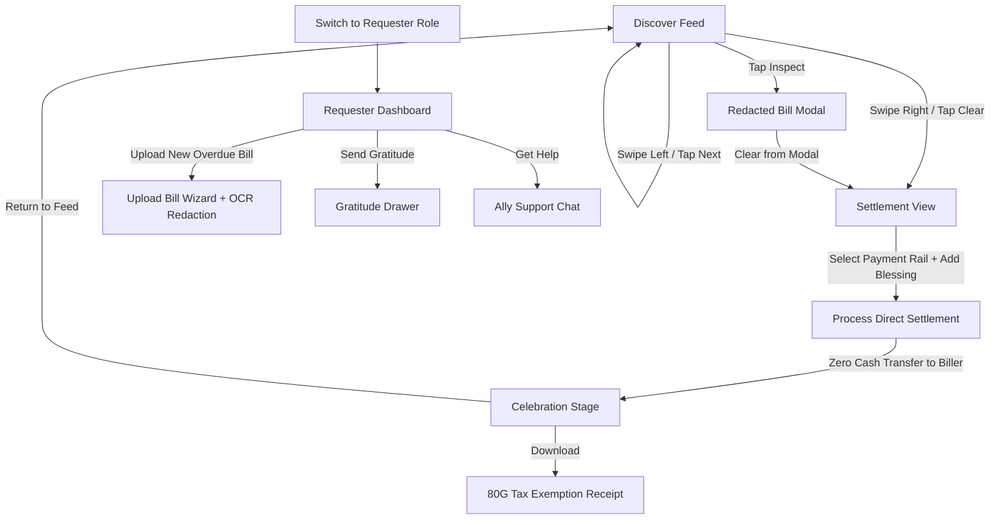

# Kindly — Direct-to-Biller Micro-Philanthropy App

<div align="center">


**Human solidarity without pity. Direct relief without leakage.**

[](https://react.dev/)
[](https://vitejs.dev/)
[](https://tailwindcss.com/)
[](#design-system--tokens)
[](https://github.com/pranvars/billapp/pulls)
[](LICENSE)

</div>

---

## 📖 Overview

**Kindly** is a mobile-first mutual aid and micro-philanthropy platform built to solve the trust, dignity, and leakage problems of traditional crowdfunding.

Rather than sending cash directly to individual bank accounts—which often raises fraud concerns and compromises recipient privacy—**Kindly enforces a strict Direct-to-Biller Settlement model**. Benefactors swipe through verified, redacted utility, medical, grocery, and education bills and pay certified service providers (e.g., electricity distribution boards, hospital billing portals, university accounts) directly through trusted rails such as Bharat BillPay (BBPS) and institutional APIs.

> **Zero Cash Transfers:** Money never touches personal accounts. 100% of contributions go directly to clearing essential liabilities with complete transparency and zero platform deductions.

---

## ✨ Core Pillars & Principles

| Principle | Description |
| :--- | :--- |
| **💳 Direct-to-Biller Rails** | Payments route directly to certified utility boards, hospitals, pharmacies, and educational institutions (e.g., BBPS, institutional gateways). |
| **🔒 Privacy by Default** | Strict cryptographic redaction: surnames, telephone numbers, and account identifiers are scrubbed (`•••• 4921`). Benefactors only see verified context. |
| **🤝 Dignity Over Charity** | Editorial storytelling replacing pity-inducing imagery. Uses editorial story prompts (*"This bill is hard because..."*, *"What this kindness would mean..."*) inspired by modern literary layouts. |
| **🔎 Verified Before Visible** | Multi-point automated OCR and human verification before any request is published to the live swipe deck. |
| **👥 Solidarity Pooling** | Supports both full bill clearances and partial community pledges so micro-gifts combine into giant relief. |
| **🧾 100% Transparent Ledger** | ₹0 platform cut ("100% Donor Funded"), ₹0 gateway fee ("Covered by Kindly"), with instant 80G tax receipt generation. |

---

## 🚀 Key Features

### 1. Tactile Swipe Deck (Discover Tab)
- **Multi-layer card stack** with realistic paper depth (`scale 0.97` and `0.93`).
- **Smooth drag physics** with dynamic tilt and stamp indicators:
  - 💚 **Right Swipe:** Emerald *"CLEAR BILL"* stamp with heart icon.
  - 🩶 **Left Swipe:** Sage *"PASS FOR NOW"* stamp.
- **Dignity Card Details:** Category badges (Electricity, Healthcare, Tuition, Groceries), urgency countdowns, verified requester badge, redacted bill details, and editorial story prompts.
- **Inspect Bill Modal:** Detailed statement breakdown with masked CA number, tariff class, consumption units, and BBPS cryptographic assurance.
- **Filter Modal:** Filter by bill category, urgency, and amount range.

### 2. Direct-to-Biller Settlement & Micro-Ledger
- **Institutional Assurance Banner:** Deep forest callout verifying direct institutional settlement.
- **Transparent Fee Breakdown:**
  - Bill Amount: `₹X,XXX`
  - Platform Fee: `₹0.00 (100% Donor Funded)`
  - Gateway Fee: `₹0.00 (Covered by Kindly)`
  - Total Paid: `Exact Bill Amount`
- **Anonymous Blessing Note:** Option to attach an encouraging, anonymous message (up to 160 characters) delivered to the requester.
- **Payment Rails:** UPI Instant Transfer (GPay, PhonePe, Paytm, Any UPI), Net Banking, and RuPay/Cards.

### 3. Celebration Stage & Tax Receipts
- **Celebration Feedback:** Tactile confetti burst with dynamic impact summary.
- **Official Settlement Reference:** Unique reference ID (e.g., `KND-2026-88412`) with one-tap clipboard copy and toast notification.
- **80G Tax Exemption Certificate:** Itemized tax receipt modal with official trust registration, PAN breakdown, and instant download/print capabilities.
- **Viral Ripple:** Shareable impact link with Web Share API and clipboard fallbacks.

### 4. Requester Activity Dashboard & Upload Wizard
- **Safe Space Greeting:** Verified member status with privacy safeguards.
- **Interactive Bill Upload Wizard:**
  - Category selector (Electricity, Medical, Tuition, Food, Water).
  - Biller name, consumer account number, amount, and due date.
  - File upload with OCR privacy-scrubbing preview.
  - Dignity story prompts composer.
- **Live Requests Stream:**
  - *Funded & Paid ✓:* View cleared receipt and send a thank-you note.
  - *Live on Deck:* Solidarity progress bar (e.g., ₹4,200 of ₹6,800 raised, 62% pledged).
  - *Under Review:* Live registry verification indicator with ~45 min SLA.
- **Gratitude Note Composer:** Write heartfelt, anonymous thank-you letters with family stamps.
- **Community Ally Support:** Simulated live care chat for assistance.

### 5. Seamless Role Switching
- Instantly switch between **Benefactor (Ally)** and **Requester (Member)** views via header pill or profile settings to test and experience both sides of the platform.

---

## 🎨 Design System & Tokens

The application features a bespoke **Warm Dignity** design aesthetic:

- **Typography:**
  - *Display / Editorial Serif:* `Newsreader` (Italic & Bold)
  - *Interface / Humanist Sans:* `Plus Jakarta Sans`
  - *Icons:* `Material Symbols Outlined` & `Lucide React`
- **Color Palette:**
  - `Deep Forest` (`#16382c`): Trust, institution, authority
  - `Rust / Coral` (`#a13e28`, `#e06d53`): Warmth, action, micro-philanthropy CTAs
  - `Deep Plum` (`#381e2f`): Refined editorial grounding
  - `Alabaster / Warm Stone` (`#fbf9f6`, `#f4efeb`): Calm, tactile paper texture
  - `Verified Teal` (`#0f766e`): Cryptographic trust and verified checkmarks
- **Haptics & Motion:**
  - Physics-based card drag and rotation
  - Spring-back returns on cancelled gestures
  - Micro-animations for confetti, toasts, drawers, and modal transitions

---

## 🛠️ Tech Stack

- **Core:** [React 18.3.1](https://react.dev/)
- **Build Tool:** [Vite 5.2.0](https://vitejs.dev/)
- **Styling:** [Tailwind CSS 3.4.1](https://tailwindcss.com/) with PostCSS & Autoprefixer
- **Icons:** [Lucide React](https://lucide.dev/) & [Google Material Symbols](https://fonts.google.com/icons)
- **Delight & Animations:** [canvas-confetti](https://www.npmjs.com/package/canvas-confetti)
- **State Management:** React Context API (`AppContext.jsx`) with local storage persistence

---

## 📂 Project Structure

```text
billapp/
├── index.html                   # HTML entry point with Google Fonts & Meta tags
├── package.json                 # Dependencies & project scripts
├── postcss.config.js            # PostCSS configuration
├── tailwind.config.js           # Custom Warm Dignity theme tokens & extensions
├── vite.config.js               # Vite bundler configuration
├── PRD.md                       # Product Requirements Document
├── Rules.md                     # Engineering & design guidelines
├── Tasks.md                     # Completed implementation roadmap
└── src/
    ├── main.jsx                 # Application root rendering
    ├── App.jsx                  # Main layout, screen routing & global modals
    ├── index.css                # Base Tailwind imports & custom utilities
    ├── context/
    │   └── AppContext.jsx       # Global state (user role, active screen, ledger, modals)
    ├── data/
    │   └── mockData.js          # Seed dataset (verified bills, billers, requests, stats)
    └── components/
        ├── celebration/
        │   ├── CelebrationView.jsx   # Kindness delivered screen & confetti stage
        │   └── TaxReceiptModal.jsx   # 80G tax certificate viewer & download
        ├── common/
        │   ├── Header.jsx            # Top navigation bar & role switcher
        │   ├── BottomNav.jsx         # Bottom navigation (Discover, Requests, Impact, Profile)
        │   └── Toast.jsx             # Animated feedback notifications
        ├── dashboard/
        │   ├── RequesterDashboard.jsx # Member dashboard & active bill statuses
        │   ├── UploadBillWizard.jsx  # Multi-step bill upload drawer
        │   ├── GratitudeDrawer.jsx   # Thank-you note sender
        │   └── AllySupportModal.jsx  # Community live support chat
        ├── deck/
        │   ├── SwipeDeck.jsx         # Touch/mouse gesture card deck engine
        │   ├── DignityCard.jsx       # Editorial bill card component
        │   ├── InspectBillModal.jsx  # Redacted official bill inspector
        │   └── FilterModal.jsx       # Category and urgency filters
        ├── impact/
        │   └── ImpactView.jsx        # Lifetime metrics, ripples, and receipts archive
        ├── profile/
        │   └── ProfileView.jsx       # User profile, privacy settings & role switch
        └── settlement/
            └── SettlementView.jsx    # Transparent micro-ledger & payment gateway
```

---

## ⚡ Getting Started

### Prerequisites

- [Node.js](https://nodejs.org/) (version `18.x` or higher recommended)
- `npm` (version `9.x` or higher)

### Installation

1. **Clone the repository:**
   ```bash
   git clone https://github.com/pranvars/billapp.git
   cd billapp
   ```

2. **Install dependencies:**
   ```bash
   npm install
   ```

3. **Start the local development server:**
   ```bash
   npm run dev
   ```

4. **Open in browser:**
   Navigate to [http://localhost:5173](http://localhost:5173) in your browser. Use responsive mobile view in Developer Tools (`Cmd + Shift + M` / `Ctrl + Shift + M`) for the optimal mobile-first experience.

---

## 🧪 Available Scripts

| Command | Action |
| :--- | :--- |
| `npm run dev` | Runs the Vite development server with Hot Module Replacement (HMR). |
| `npm run build` | Compiles and optimizes assets into the `dist/` directory for production. |
| `npm run preview` | Locally serves the production build from `dist/` for verification. |

---

## 🔄 User Journey & Flows



---

## 🛡️ Security & Privacy Assurance

- **Zero Bank Transfer Exposure:** Benefactors never receive private bank account numbers, IFSC codes, or UPI VPA handles of recipients.
- **Redacted Documentation:** All bills uploaded undergo sensitive data scrubbing. Full account numbers, phone numbers, and physical residential addresses are permanently masked before card generation.
- **Auditable Records:** Each settled transaction generates a verifiable reference code tied to certified utility boards and institutional billers.

---

## 🤝 Contributing

Contributions, feature ideas, and feedback are warmly welcomed!

1. Fork the Project
2. Create your Feature Branch (`git checkout -b feature/AmazingFeature`)
3. Commit your Changes (`git commit -m 'Add some AmazingFeature'`)
4. Push to the Branch (`git push origin feature/AmazingFeature`)
5. Open a Pull Request

---

## 📄 License

This project is open-source and distributed under the [MIT License](LICENSE).
